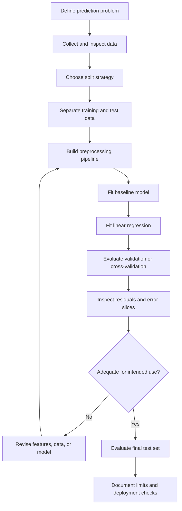

# Linear Regression: Complete Theory, Mathematics, Intuition & Implementation

> A carefully structured, GitHub-ready learning reference for linear
> regression---from the geometry of a best-fit line to statistical
> assumptions, optimization, diagnostics, model variants, and end-to-end
> Python workflows.


## Contents

-   [1. Learning roadmap](#1-learning-roadmap)
-   [2. Regression and prediction
    tasks](#2-regression-and-prediction-tasks)
-   [3. Relationship types](#3-relationship-types)
-   [4. Terminology and notation](#4-terminology-and-notation)
-   [5. Simple linear regression](#5-simple-linear-regression)
-   [6. Multiple linear regression](#6-multiple-linear-regression)
-   [7. Geometry and intuition](#7-geometry-and-intuition)
-   [8. Ordinary least squares
    derivation](#8-ordinary-least-squares-derivation)
-   [9. Loss functions and metrics](#9-loss-functions-and-metrics)
-   [10. Gradient descent from first
    principles](#10-gradient-descent-from-first-principles)
-   [11. Assumptions and their
    meaning](#11-assumptions-and-their-meaning)
-   [12. Residual diagnostics](#12-residual-diagnostics)
-   [13. Types and related models](#13-types-and-related-models)
-   [14. Feature engineering and
    preprocessing](#14-feature-engineering-and-preprocessing)
-   [15. Regularization](#15-regularization)
-   [16. Training and validation
    workflow](#16-training-and-validation-workflow)
-   [17. Python implementations](#17-python-implementations)
-   [18. Complete example with a
    pipeline](#18-complete-example-with-a-pipeline)
-   [19. Statistical inference](#19-statistical-inference)
-   [20. Interpretation, causality, and
    limitations](#20-interpretation-causality-and-limitations)
-   [21. Common failure modes](#21-common-failure-modes)
-   [22. Interview questions](#22-interview-questions)
-   [23. Exercises with solutions](#23-exercises-with-solutions)
-   [24. Terminology glossary](#24-terminology-glossary)
-   [25. Checklist for a serious
    project](#25-checklist-for-a-serious-project)
-   [26. Further reading](#26-further-reading)
-   [Appendices](#appendices)

------------------------------------------------------------------------

## 1. Learning roadmap

Linear regression is a useful first model because its prediction rule is
simple enough to derive, yet rich enough to teach core machine-learning
ideas.

### Recommended order

1.  Understand the prediction problem and the meaning of a feature and
    target.
2.  Learn the equation for a line and interpret slope and intercept.
3.  Understand residuals and why a line will not normally pass through
    every observation.
4.  Learn why least squares squares residuals and minimizes their sum.
5.  Derive the simple-regression coefficients.
6.  Generalize the equation to several features using matrix notation.
7.  Compare a closed-form least-squares solver with gradient descent.
8.  Understand MSE, MAE, RMSE, and (R\^2).
9.  Learn the assumptions that matter for interpretation and inference.
10. Build residual plots and evaluate on data not used to fit the model.
11. Learn polynomial features, interactions, Ridge, Lasso, and Elastic
    Net.
12. Build a reproducible pipeline and document limitations.

### What you should be able to explain without memorizing

-   Why the least-squares line is a particular line, rather than an
    arbitrary line.
-   Why residuals are signed as actual minus predicted.
-   Why the squared-error objective is convenient and what its
    weaknesses are.
-   Why a model can fit training data well but generalize poorly.
-   Why (R\^2) is not the percentage of predictions that are correct.
-   Why an estimated coefficient is not automatically a causal effect.
-   Why preprocessing must be fitted only on the training portion of the
    data.

------------------------------------------------------------------------

## 2. Regression and prediction tasks

### 2.1 What is supervised learning?

In supervised learning, examples include inputs and a known target. A
learning algorithm uses training examples to estimate a rule that maps
inputs to targets.

Let an observation contain features (x) and target (y). The model learns
a function (f) and produces:

\[ `\hat `{=tex}y = f(x) \]

The hat symbol indicates an estimate or prediction. The actual target
(y) is observed; the predicted target (`\hat `{=tex}y) is produced by
the model.

### 2.2 What is regression?

Regression predicts a numeric quantity, such as price, time, demand,
temperature, or energy consumption. The numeric output can be
continuous, though in practice it may be rounded or constrained.

Examples:

-   Estimate a home's selling price from its characteristics.
-   Predict next week's product demand.
-   Estimate delivery time from route and traffic information.
-   Predict energy use from weather and building characteristics.

### 2.3 Regression versus classification

  -----------------------------------------------------------------------
  Question                Regression              Classification
  ----------------------- ----------------------- -----------------------
  What is predicted?      Numeric quantity        Class or category

  Example target          Sale price              Fraud / not fraud

  Common metrics          MAE, RMSE, (R\^2)       Precision, recall, F1,
                                                  log loss

  Typical output          `245000.0`              `fraud` or class
                                                  probabilities

  Common algorithms       Linear regression,      Logistic regression,
                          random forest regressor random forest
                                                  classifier
  -----------------------------------------------------------------------

The type of task depends on the meaning of the target, not merely
whether the target is represented by numbers. A postal code is usually a
category, not a measured quantity.

### 2.4 What does "linear" mean?

A model is linear in its coefficients when the coefficients enter
additively and are not multiplied by each other or passed through
nonlinear functions.

\[ `\hat `{=tex}y = b_0+b_1x \]

is linear in (b_0,b_1).

So is:

\[ `\hat `{=tex}y=b_0+b_1x+b_2x\^2 \]

The second model produces a curved relationship as (x) changes, but it
remains linear in the coefficients (b_0,b_1,b_2). It is usually called
polynomial regression, implemented as linear regression on polynomial
features.

------------------------------------------------------------------------

## 3. Relationship types

A relationship describes how the expected target changes with one or
more inputs. Before choosing a model, visualize the data and ask whether
a straight-line approximation is plausible.

### 3.1 Positive linear relationship

As (x) increases, the fitted target tends to increase.

\[ `\hat `{=tex}y=b_0+b_1x,`\qquad `{=tex}b_1\>0 \]

Examples might include a positive association between house area and
price in a particular dataset. The real relationship can still contain
noise and exceptions.

### 3.2 Negative linear relationship

As (x) increases, the fitted target tends to decrease.

\[ `\hat `{=tex}y=b_0+b_1x,`\qquad `{=tex}b_1\<0 \]

For example, a dataset might show lower remaining battery life as device
usage increases. Whether a straight line is appropriate depends on the
observed range and context.

### 3.3 No clear linear relationship

A fitted slope close to zero means little linear change in the target
across the feature's observed range. It does **not** prove that the
feature is irrelevant: a U-shaped relationship can have a small linear
slope while containing a strong nonlinear pattern.

### 3.4 Nonlinear relationships

Examples include quadratic, logarithmic, exponential, periodic, and
saturation patterns. Ordinary linear regression on a raw single feature
may not represent these patterns well. Feature transformations, splines,
or another model family may be more suitable.


### 3.5 Correlation is not the same as regression

Correlation summarizes association between variables, usually
symmetrically. Regression models a target conditionally on predictors
and provides a prediction rule.

A correlation coefficient does not by itself give the intercept,
residual distribution, causal direction, or quality of a prediction
model.

### 3.6 Relationship does not imply causation

A predictor can be associated with the target because of confounding,
selection, measurement, or another common cause. A predictive model can
be useful without identifying a causal effect. Causal questions require
a design and assumptions beyond fitting a regression equation.

------------------------------------------------------------------------

## 4. Terminology and notation

  ------------------------------------------------------------------------
  Symbol / term                        Meaning
  ------------------------------------ -----------------------------------
  \(n\)                                Number of observations

  \(p\)                                Number of predictors/features

  (x_i)                                Feature value or feature vector for
                                       observation (i)

  (y_i)                                Observed target for observation (i)

  (`\hat `{=tex}y_i)                   Predicted target for observation
                                       (i)

  (b_0)                                Estimated intercept

  (b_j)                                Estimated coefficient for feature
                                       (j)

  (`\beta`{=tex}\_j)                   Population or generic model
                                       coefficient notation

  (e_i)                                Theoretical error term in a
                                       statistical model

  (r_i)                                Residual computed from observed and
                                       fitted values

  \(X\)                                Design matrix

  (`\mathbf `{=tex}y)                  Target vector

  (`\boldsymbol`{=tex}`\beta`{=tex})   Coefficient vector

  (SSE)                                Sum of squared errors/residuals

  (MSE)                                Mean squared error

  (MAE)                                Mean absolute error

  (RMSE)                               Root mean squared error

  (R\^2)                               Coefficient of determination

  (`\alpha`{=tex})                     Often a learning rate or
                                       regularization parameter, depending
                                       on context

  (`\lambda`{=tex})                    Common notation for regularization
                                       strength

  (J(`\theta`{=tex}))                  Objective/cost function

  (`\nabla `{=tex}J)                   Gradient of the objective
  ------------------------------------------------------------------------

### 4.1 Feature, target, sample, and parameter

A **feature** is an input variable. The **target** is the quantity to
predict. An **observation** is one row or example. A **parameter** is a
quantity learned by the model, such as a slope or intercept.

### 4.2 Actual, predicted, error, and residual

The residual is:

\[ r_i=y_i-`\hat `{=tex}y_i \]

-   (r_i\>0): the model predicted below the observed target.
-   (r_i\<0): the model predicted above the observed target.
-   (r_i=0): prediction equals the observed target.

A theoretical error term is not directly observed because the true
population relationship is unknown. A residual is calculated after
fitting a model.

### 4.3 Training, validation, and test sets

-   **Training set:** used to fit model parameters.
-   **Validation set:** used to compare choices such as features or
    regularization.
-   **Test set:** held back for final evaluation after modeling choices
    are complete.

Repeatedly tuning a model against the test set makes the test set part
of the selection process and weakens its role as an unbiased final
check.

------------------------------------------------------------------------

## 5. Simple linear regression

Simple linear regression models a target using one predictor:

\[ `\boxed{\hat y=b_0+b_1x}`{=tex} \]

### 5.1 Intercept (b_0)

The intercept is the fitted prediction at (x=0). It positions the line
vertically. If zero is outside the meaningful data range, the intercept
may be mathematically necessary but practically uninteresting.

### 5.2 Slope (b_1)

The slope describes the change in the fitted target for a one-unit
increase in (x).

If (b_1=2.5), then increasing (x) by 4 units changes the fitted
prediction by:

\[ `\Delta `{=tex}`\hat `{=tex}y=b_1`\Delta `{=tex}x=2.5(4)=10 \]

The units of the slope are target-units per feature-unit.

### 5.3 Numerical example

Suppose the fitted equation is:

\[ `\hat `{=tex}y=40+0.18x \]

At (x=1000):

\[ `\hat `{=tex}y=40+0.18(1000)=220 \]

This is a prediction in the target's units. The values are illustrative,
not a real price estimate.

### 5.4 Observations and fitted line


The points are observations. The line represents the fitted conditional
trend. The vertical dashed gaps are residuals. Least squares chooses the
line to minimize the sum of squared residuals, not to minimize every
vertical gap separately.

### 5.5 When simple regression is useful

-   Exploring a single feature's linear association with a target.
-   Establishing a simple baseline.
-   Teaching coefficient interpretation and least squares.
-   Checking whether a more complex model may be warranted.

It can be misleading if other important predictors, nonlinear structure,
or data collection issues are ignored.

------------------------------------------------------------------------

## 6. Multiple linear regression

Multiple linear regression uses (p) predictors:

\[ `\boxed{\hat y=b_0+b_1x_1+b_2x_2+\cdots+b_px_p}`{=tex} \]

For example, a house-price model might include area, age, bedroom count,
and distance to transit.

### 6.1 Coefficient interpretation

A coefficient describes the change in fitted prediction for a one-unit
increase in that predictor while holding the other included predictors
fixed.

For an illustrative model:

\[ `\widehat{price}`{=tex}=50000+120(area)+8000(bedrooms)-900(age) \]

-   Area coefficient: +120 target units per area unit, conditional on
    other listed predictors.
-   Bedroom coefficient: +8000 units per additional bedroom, holding
    area and age fixed.
-   Age coefficient: -900 units per year, holding area and bedroom count
    fixed.

These are fictional numbers. Correlated predictors can make individual
coefficient estimates unstable. A conditional coefficient is not
automatically a causal effect.

### 6.2 Matrix notation

The model can be written:

\[
`\mathbf `{=tex}y=X`\boldsymbol`{=tex}`\beta`{=tex}+`\boldsymbol`{=tex}`\epsilon`{=tex}
\]

With an intercept included as the first column of ones:

-   \(X\) has shape (n`\times`{=tex}(p+1)).
-   (`\boldsymbol`{=tex}`\beta`{=tex}) has shape ((p+1)`\times1`{=tex}).
-   (`\mathbf `{=tex}y) has shape (n`\times1`{=tex}).
-   (`\boldsymbol`{=tex}`\epsilon`{=tex}) represents unmodeled
    deviations.

Predictions are:

\[ `\hat{\mathbf y}`{=tex}=X`\hat{\boldsymbol\beta}`{=tex} \]

This representation is the bridge between the simple equation and the
matrix-based implementations used by numerical libraries.

### 6.3 Why adding features can help---or hurt

A relevant feature may explain variation left in the residuals. An
irrelevant or noisy feature may increase variance, reduce
interpretability, or create numerical problems. A feature that leaks
future information can make evaluation meaningless. Feature selection
should be guided by the prediction task, domain understanding, and
validation---not by the training score alone.

------------------------------------------------------------------------

## 7. Geometry and intuition

### 7.1 What is a best-fit line?

There are infinitely many possible lines. Each line gives a prediction
(`\hat `{=tex}y_i) for every observed (x_i). Comparing each prediction
with the corresponding (y_i) produces residuals. Least squares chooses
coefficients that minimize the sum of their squares.

\[
SSE(b_0,b_1)=`\sum`{=tex}\_{i=1}^{n}`\left[y_i-(b_0+b_1x_i)\right]`{=tex}^2
\]

The function is a quadratic in the coefficients. For ordinary least
squares, this objective is convex, so any global minimum is also a
minimum of the objective.

### 7.2 Why square residuals?

1.  Positive and negative residuals cannot cancel.
2.  Large residuals receive more penalty than small residuals.
3.  The resulting objective is differentiable.
4.  Its derivatives lead to a convenient closed-form solution for
    ordinary least squares.

The downside is that outliers can have a strong effect because their
residuals are squared.

### 7.3 The line passes through the sample means

For ordinary least squares with an intercept, the fitted line passes
through ((`\bar `{=tex}x,`\bar `{=tex}y)). This follows from the
first-order condition for the intercept, which makes the training
residuals sum to zero.

This property does not mean that all residuals are zero, that residuals
are normally distributed, or that the model assumptions are satisfied.

### 7.4 Visualizing the objective


The curve illustrates how mean squared error changes across candidate
slopes when the intercept is optimized for each slope. The minimum
corresponds to the least-squares slope for this illustrative dataset.

------------------------------------------------------------------------

## 8. Ordinary least squares derivation

### 8.1 Define the objective

For simple regression:

\[ J(b_0,b_1)=`\sum`{=tex}\_{i=1}^{n}\[y_i-(b_0+b_1x_i)\]^2 \]

We want the values of (b_0) and (b_1) that minimize (J).

### 8.2 Differentiate with respect to the intercept

\[ `\frac{\partial J}{\partial b_0}`{=tex}
=-2`\sum`{=tex}\_{i=1}\^{n}\[y_i-b_0-b_1x_i\] \]

At the minimum, set the derivative to zero:

\[ `\sum`{=tex}\_{i=1}\^{n}(y_i-b_0-b_1x_i)=0 \]

Rearrange:

\[ `\sum `{=tex}y_i=nb_0+b_1`\sum `{=tex}x_i \]

Divide by (n):

\[ `\bar `{=tex}y=b_0+b_1`\bar `{=tex}x \]

Therefore:

\[ `\boxed{b_0=\bar y-b_1\bar x}`{=tex} \]

### 8.3 Differentiate with respect to the slope

\[ `\frac{\partial J}{\partial b_1}`{=tex}
=-2`\sum`{=tex}\_{i=1}\^{n}x_i\[y_i-b_0-b_1x_i\] \]

Set it to zero and substitute the intercept relation. After centering
the variables and simplifying:

\[ `\boxed{
b_1=
\frac{\sum_{i=1}^{n}(x_i-\bar x)(y_i-\bar y)}
{\sum_{i=1}^{n}(x_i-\bar x)^2}
}`{=tex} \]

Then:

\[ `\boxed{b_0=\bar y-b_1\bar x}`{=tex} \]

The denominator is the variation in (x). If all (x_i) values are
identical, the denominator is zero and the slope cannot be identified
from those observations.

### 8.4 Matrix derivation

The sum of squared residuals can be written:

\[
J(`\boldsymbol`{=tex}`\beta`{=tex})=(`\mathbf `{=tex}y-X`\boldsymbol`{=tex}`\beta`{=tex})\^T
(`\mathbf `{=tex}y-X`\boldsymbol`{=tex}`\beta`{=tex}) \]

Expanding and differentiating:

\[
`\nabla`{=tex}\_{`\boldsymbol`{=tex}`\beta`{=tex}}J=-2X^T`\mathbf `{=tex}y+2X^TX`\boldsymbol`{=tex}`\beta`{=tex}
\]

Set the gradient to zero:

\[ X^TX`\hat{\boldsymbol\beta}`{=tex}=X^T`\mathbf `{=tex}y \]

These are the normal equations. If (X\^TX) is invertible:

\[ `\boxed{\hat{\boldsymbol\beta}=(X^TX)^{-1}X^T\mathbf y}`{=tex} \]

### 8.5 Numerical stability

Do not normally compute the inverse explicitly in code. Use a
least-squares solver such as `numpy.linalg.lstsq`, QR decomposition, or
singular value decomposition. Strong collinearity can make (X\^TX)
singular or poorly conditioned.

### 8.6 Closed-form solution versus gradient descent

  -----------------------------------------------------------------------
  Aspect                  OLS solver              Gradient descent
  ----------------------- ----------------------- -----------------------
  Core idea               Solve least-squares     Repeatedly update
                          equations numerically   coefficients

  Iterations              Not usually exposed as  Requires a step size
                          manual iterations       and stopping rule

  Scale sensitivity       Numerical conditioning  Scaling often strongly
                          still matters           affects convergence

  Learning goal           Useful production       Useful for
                          baseline                understanding
                                                  optimization and larger
                                                  workflows

  Failure modes           Rank deficiency,        Divergence, slow
                          conditioning, bad       convergence, poor
                          inputs                  stopping
  -----------------------------------------------------------------------

Both methods can minimize the same least-squares objective. A trusted
library solver is usually the simplest choice for ordinary tabular
regression.

------------------------------------------------------------------------

## 9. Loss functions and metrics

### 9.1 Sum of squared errors (SSE)

\[ SSE=`\sum`{=tex}\_{i=1}^{n}(y_i-`\hat `{=tex}y_i)^2 \]

SSE measures total squared residual magnitude. Its value tends to
increase with sample size, so it is not directly comparable across
datasets with different numbers of observations.

### 9.2 Mean squared error (MSE)

\[ `\boxed{MSE=\frac{1}{n}\sum_{i=1}^{n}(y_i-\hat y_i)^2}`{=tex} \]

MSE is the average squared residual. Its units are squared target units.

**Intuition:** if most errors are small but a few are very large, the
large errors can dominate MSE.

### 9.3 Mean absolute error (MAE)

\[ `\boxed{MAE=\frac{1}{n}\sum_{i=1}^{n}|y_i-\hat y_i|}`{=tex} \]

MAE is in the original target units. It is easier to explain as average
absolute error and less sensitive to a few large residuals than MSE.

### 9.4 Root mean squared error (RMSE)

\[ `\boxed{RMSE=\sqrt{MSE}}`{=tex} \]

RMSE is in the target's units, while retaining a stronger penalty for
large residuals than MAE.

### 9.5 Coefficient of determination (R\^2)

With the standard mean-baseline definition:

\[ `\boxed{R^2=1-\frac{\sum_i(y_i-\hat y_i)^2}
{\sum_i(y_i-\bar y)^2}}`{=tex} \]

-   (R\^2=1): perfect predictions on the evaluated observations.
-   (R\^2=0): the model's SSE equals the mean-baseline sum of squares.
-   (R\^2\<0): the model has greater SSE than that baseline on the
    evaluated data.

**Important:** (R\^2) is not a percentage of predictions that are
correct. It does not establish causality, fairness, or deployment
suitability.

### 9.6 Adjusted (R\^2)

A common formula for an intercept model with (p) predictors and (n)
observations is:

\[ R^2\_{adj}=1-(1-R^2)`\frac{n-1}{n-p-1}`{=tex} \]

This requires (n\>p+1) and the usual degrees-of-freedom setup. Adjusted
(R\^2) is a descriptive adjustment, not a replacement for validation.

### 9.7 Choose metrics based on the application

  -----------------------------------------------------------------------
  Metric                  Useful when             Caution
  ----------------------- ----------------------- -----------------------
  MAE                     Typical absolute        Treats all error
                          deviation is easy to    magnitudes linearly
                          explain                 

  MSE                     Large residuals should  Squared units can be
                          be strongly penalized   hard to interpret

  RMSE                    Need target units with  A few outliers can
                          extra sensitivity to    dominate
                          large errors            

  (R\^2)                  Want a relative         Can be negative; not a
                          comparison with a mean  percent-correct score
                          baseline                

  Median absolute error   Want a robust           Hides the worst tail
                          typical-error summary   errors

  MAPE                    Relative error is       Undefined at zero and
                          meaningful and targets  unstable near zero
                          stay away from zero     
  -----------------------------------------------------------------------

Always state which dataset split produced a metric, what the target
units are, and how the model compares with a baseline.

------------------------------------------------------------------------

## 10. Gradient descent from first principles

### 10.1 What is gradient descent?

Gradient descent is an iterative optimization method. It starts with
parameter values, calculates the gradient of the objective, and updates
parameters in the direction that reduces the objective.

\[ `\boxed{\theta\leftarrow\theta-\alpha\nabla_\theta J(\theta)}`{=tex}
\]

Here (`\alpha`{=tex}) is the learning rate. It controls the step size.

### 10.2 Derivatives for linear regression

For (n) observations and predictions (`\hat `{=tex}y_i=b_0+b_1x_i),
define:

\[
J(b_0,b_1)=`\frac{1}{n}`{=tex}`\sum`{=tex}\_i(`\hat `{=tex}y_i-y_i)\^2
\]

Then:

\[ `\frac{\partial J}{\partial b_0}`{=tex}
=`\frac{2}{n}`{=tex}`\sum`{=tex}\_i(`\hat `{=tex}y_i-y_i) \]

\[ `\frac{\partial J}{\partial b_1}`{=tex}
=`\frac{2}{n}`{=tex}`\sum`{=tex}\_i x_i(`\hat `{=tex}y_i-y_i) \]

The updates are:

\[
b_0`\leftarrow `{=tex}b_0-`\alpha`{=tex}`\frac{\partial J}{\partial b_0}`{=tex}
\]

\[
b_1`\leftarrow `{=tex}b_1-`\alpha`{=tex}`\frac{\partial J}{\partial b_1}`{=tex}
\]

Some texts define the cost with a factor of (1/(2n)). That convention
removes the factor 2 in the gradients. Either is correct when used
consistently.

### 10.3 Batch gradient descent workflow

1.  Initialize coefficients.
2.  Compute predictions for all training examples.
3.  Calculate residuals.
4.  Calculate the loss.
5.  Compute each gradient.
6.  Update coefficients.
7.  Repeat.
8.  Inspect the loss curve and evaluate on validation data.


### 10.4 Learning-rate behavior

-   Too small: slow progress.
-   Reasonable: loss decreases and settles.
-   Too large: the objective may oscillate, overshoot, or diverge.

Feature scaling can improve optimization because features measured on
very different scales produce differently scaled gradients.

### 10.5 Stopping criteria

Possible criteria include a maximum iteration count, small change in
loss, small gradient norm, or small parameter update. Reaching a chosen
iteration count does not prove convergence.

### 10.6 Batch, stochastic, and mini-batch methods

-   **Batch:** each update uses all training observations.
-   **Stochastic:** each update uses one observation.
-   **Mini-batch:** each update uses a subset.

Mini-batches can reduce memory needs and produce frequent updates, but
the loss path is noisier. For small tabular datasets, a standard
least-squares solver is often simpler.

------------------------------------------------------------------------

## 11. Assumptions and their meaning

Assumptions are not all needed merely to compute predictions. They
matter for different reasons: unbiased coefficient estimation,
uncertainty estimates, interpretation, or inference.

### 11.1 Linearity in parameters

The model's conditional mean is represented by a linear combination of
the chosen features and coefficients. A straight line in a raw feature
may be too simple; adding a square, interaction, or spline basis can
represent curvature while retaining linearity in coefficients.

### 11.2 Independent observations or errors

Dependence can occur in time series, repeated measurements, households,
schools, or geographic clusters. Randomly splitting dependent rows can
make evaluation too optimistic.

### 11.3 Homoscedasticity

Homoscedasticity means conditional error variance is constant across
relevant predictor values or fitted values. If variance changes,
coefficient estimates may still be computable, but classical standard
errors can be unreliable.

### 11.4 No perfect multicollinearity

No predictor should be an exact linear combination of other predictors.
Perfect collinearity prevents unique estimation of all coefficients.
Strong but imperfect collinearity can make estimates unstable.

### 11.5 Zero conditional mean / exogeneity

For a causal or classical statistical interpretation, the predictors
should not have a systematic relationship with the unmodeled error in
the relevant conditional sense. Omitted confounders, selection, or
measurement problems can violate this condition.

### 11.6 Normality

Normally distributed errors are used for certain exact small-sample
inference results under classical assumptions. Normality is not required
to calculate an ordinary least-squares fit. Large samples and robust
inference require separate reasoning rather than a simplistic normality
rule.

### 11.7 Assumptions are not a checklist that proves a model is good

Inspect data collection, split design, residuals, and the intended use.
A diagnostic plot cannot prove all assumptions, and a high score cannot
prove that a model is scientifically appropriate.

------------------------------------------------------------------------

## 12. Residual diagnostics

Residuals can reveal structure the model has not captured. Diagnostics
should be based on suitable training or validation residuals, and final
performance should still be evaluated on held-out data.


### 12.1 Residual-versus-fitted plot

A roughly patternless cloud around zero is often reassuring. Curvature
suggests the mean relationship may be nonlinear. A funnel can suggest
changing variance. Clusters may suggest group structure or omitted
variables.

### 12.2 Actual-versus-predicted plot


Points near the diagonal have predictions close to observed targets. Use
held-out predictions for the final plot when assessing generalization.

### 12.3 Q--Q plot

A Q--Q plot compares residual quantiles with theoretical normal
quantiles. Departures, particularly in the tails, can suggest
non-normality or outliers. Interpretation depends on sample size and
whether classical inference is the goal.

### 12.4 Outliers, leverage, and influence

-   **Outlier:** unusual response or residual.
-   **High leverage:** unusual predictor values.
-   **Influential point:** a point whose inclusion changes the fitted
    model materially.

These concepts overlap but are not identical. Investigate unusual
observations; do not automatically delete them.

### 12.5 Autocorrelation

If residuals are ordered in time, plot them against time and examine
dependence. Standard random splits and ordinary standard errors may be
inappropriate for time-dependent data.

------------------------------------------------------------------------

## 13. Types and related models

"Types of linear regression" can refer to several different dimensions:
number of predictors, feature basis, fitting objective, or
regularization. These categories overlap rather than forming one
exclusive list.

### 13.1 Simple linear regression

One predictor:

\[ `\hat `{=tex}y=b_0+b_1x \]

Use it for a simple trend or a teaching baseline.

### 13.2 Multiple linear regression

Several predictors:

\[ `\hat `{=tex}y=b_0+`\sum`{=tex}\_{j=1}\^{p}b_jx_j \]

Use it when multiple input variables contribute useful information.

### 13.3 Polynomial regression

Polynomial features model curvature:

\[ `\hat `{=tex}y=b_0+b_1x+b_2x^2+`\cdots`{=tex}+b_dx^d \]

It is still linear in the coefficients. Increasing degree can overfit
and cause unstable extrapolation.

### 13.4 Interaction regression

An interaction allows the association of one predictor to depend on
another:

\[ `\hat `{=tex}y=b_0+b_1x_1+b_2x_2+b_3x_1x_2 \]

The effect associated with (x_1) is (b_1+b_3x_2), so the (x_1) effect
varies with (x_2).

### 13.5 Ridge regression

Ridge adds an L2 penalty to the squared-error objective:

\[
J(`\boldsymbol`{=tex}`\beta`{=tex})=SSE+`\lambda`{=tex}`\sum`{=tex}\_{j=1}\^{p}`\beta`{=tex}\_j\^2
\]

The intercept is usually not penalized. Ridge shrinks coefficients but
generally does not set them exactly to zero. Feature scaling matters.

### 13.6 Lasso regression

Lasso adds an L1 penalty:

\[
J(`\boldsymbol`{=tex}`\beta`{=tex})=SSE+`\lambda`{=tex}`\sum`{=tex}\_{j=1}\^{p}\|`\beta`{=tex}\_j\|
\]

Lasso can set coefficients exactly to zero, giving a sparse solution.
With correlated features, which feature remains selected can be
unstable.

### 13.7 Elastic Net

Elastic Net combines L1 and L2 penalties. It can be useful when there
are many predictors and correlated groups of features. Both
regularization strength and the L1/L2 mixing parameter need selection.

### 13.8 Weighted least squares

Weighted least squares minimizes:

\[ `\sum`{=tex}\_{i=1}^{n}w_i(y_i-`\hat `{=tex}y_i)^2 \]

Observations receive different weights. Weights should reflect a
defensible sampling or variance model, not be chosen merely to improve a
score.

### 13.9 Robust regression

Robust methods reduce sensitivity to certain outliers by using different
objectives or estimators. Examples include Huber regression and RANSAC.
They change the fitting procedure and assumptions; they are not
interchangeable with ordinary least squares.

### 13.10 Quantile regression

Quantile regression models a conditional quantile, such as the median,
rather than the conditional mean. It can answer questions about the
upper or lower part of a target distribution.

### 13.11 Logistic regression is not linear regression for a continuous target

Logistic regression is generally used for classification. It models a
transformed probability (log-odds) using a linear predictor. It belongs
to the broader family of generalized linear models, but it is not
ordinary least-squares regression.

### 13.12 Generalized linear models

Generalized linear models combine a linear predictor with a link
function and a response distribution. Logistic and Poisson regression
are common examples. They extend the modeling framework beyond a
normally distributed continuous response.

### 13.13 Quick comparison

  -----------------------------------------------------------------------
  Model                   Main idea               Typical reason to
                                                  consider it
  ----------------------- ----------------------- -----------------------
  Simple OLS              One predictor, squared  Explain a basic linear
                          loss                    trend

  Multiple OLS            Multiple predictors,    Conditional prediction
                          squared loss            with several features

  Polynomial              Add powers of features  Model curvature

  Interaction model       Include product terms   Effects vary with
                                                  another feature

  Ridge                   L2 penalty              Shrink unstable
                                                  coefficients

  Lasso                   L1 penalty              Sparse coefficients /
                                                  feature selection

  Elastic Net             L1 + L2 penalties       Sparse model with
                                                  correlated features

  Weighted least squares  Weighted squared        Known or defensible
                          residuals               variance differences

  Huber / robust          Less sensitivity to     Outlier-resistant
  regression              large residuals         fitting

  Quantile regression     Conditional quantile    Predict median or
                                                  another quantile

  Logistic regression     Link-based probability  Classification
                          model                   

  Poisson regression      Count response with a   Count modeling
                          log link in a common    
                          setup                   
  -----------------------------------------------------------------------

------------------------------------------------------------------------

## 14. Feature engineering and preprocessing

### 14.1 Missing values

Inspect why values are missing before choosing an imputation strategy.
Median imputation is a common numeric baseline; most-frequent imputation
is common for categories. Missingness indicators can sometimes be
informative, but require domain reasoning.

### 14.2 Categorical features

Nominal categories usually should not be encoded as arbitrary integers.
One-hot encoding creates indicator columns and allows category-specific
offsets relative to a reference or representation.

### 14.3 Standardization

For feature (x_j), standardization uses:

\[ z_j=`\frac{x_j-\mu_j}{\sigma_j}`{=tex} \]

The mean and standard deviation must be learned from the training data
only. Constant features need special handling. Scaling is particularly
important for penalized regression and often helpful for gradient-based
optimization.

### 14.4 Interactions and polynomial features

A transformation may improve the representation when domain knowledge or
residual diagnostics suggest a nonlinear relationship. All
feature-generation steps must be fitted within the training pipeline to
avoid leakage during cross-validation.

### 14.5 Data leakage

Leakage occurs when training or evaluation uses information unavailable
at the prediction time. Examples include fitting a scaler on the full
dataset, using future outcomes as features, or choosing features based
on test labels.

### 14.6 Extrapolation

A linear model can predict any numeric input, but this does not mean its
relationship remains valid outside the observed feature range. Flag
out-of-range values and consider uncertainty or constraints.

------------------------------------------------------------------------

## 15. Regularization

### 15.1 Why regularize?

When many features are noisy or correlated, ordinary least-squares
coefficients can have high variance. Regularization adds a penalty that
discourages large coefficients. This introduces a bias-variance
trade-off: some bias may be accepted to improve generalization.

### 15.2 Ridge penalty

\[
J(`\boldsymbol`{=tex}`\beta`{=tex})=SSE+`\lambda`{=tex}`\sum`{=tex}\_{j=1}\^{p}`\beta`{=tex}\_j\^2
\]

Larger (`\lambda`{=tex}) generally produces stronger shrinkage. The
intercept is typically excluded from the penalty.

### 15.3 Lasso penalty

\[
J(`\boldsymbol`{=tex}`\beta`{=tex})=SSE+`\lambda`{=tex}`\sum`{=tex}\_{j=1}\^{p}\|`\beta`{=tex}\_j\|
\]

The corner in the L1 penalty makes exact zero coefficients possible.
Lasso feature selection is not guaranteed to identify the true causal or
important features.

### 15.4 Elastic Net penalty

One common form is:

\[ J(`\boldsymbol`{=tex}`\beta`{=tex})=SSE+`\lambda`{=tex}`\left[
\rho\sum_j|\beta_j|+(1-\rho)\sum_j\beta_j^2
\right]`{=tex}\]

Here (`\rho`{=tex}) controls the mixture. Exact parameterization differs
across libraries, so consult the chosen API's documentation.

### 15.5 Tune without test leakage

Use a validation set or cross-validation on the training data to choose
regularization strength. Keep preprocessing and the estimator inside one
pipeline. Evaluate the selected model on the held-out test set once the
choices are finalized.

------------------------------------------------------------------------

## 16. Training and validation workflow



### Step 1: Define the task

Specify the target, units, prediction time, population, and consequences
of errors.

### Step 2: Inspect the data

Check shape, types, missingness, duplicates, target distribution,
suspicious values, and feature units.

### Step 3: Select a suitable split

Use random splits only when they reflect deployment. For future
prediction, use time-aware evaluation. For new people, devices, or
locations, consider group-aware evaluation.

### Step 4: Establish a baseline

A mean or median predictor gives a simple reference. A model that does
not beat a relevant baseline may not be useful.

### Step 5: Build a pipeline

Keep imputation, encoding, scaling, feature generation, and model
fitting together. This helps prevent inconsistent preprocessing and
leakage.

### Step 6: Evaluate multiple dimensions

Report MAE or RMSE, (R\^2) where meaningful, a baseline comparison,
residual diagnostics, and subgroup performance when appropriate.

### Step 7: Review limitations

Consider extrapolation, data quality, distribution shift, error costs,
and whether coefficients are being interpreted causally without
justification.

------------------------------------------------------------------------

## 17. Python implementations

### 17.1 Ordinary least squares with NumPy

``` python
import numpy as np

X = np.array([[1], [2], [3], [4], [5]], dtype=float)
y = np.array([3, 5, 7, 9, 11], dtype=float)

# Add an intercept column.
X_design = np.column_stack([np.ones(len(X)), X])

# Solve least squares without explicitly calculating a matrix inverse.
coefficients, residuals, rank, singular_values = np.linalg.lstsq(
    X_design, y, rcond=None
)

intercept = coefficients[0]
slope = coefficients[1]

print("Intercept:", intercept)
print("Slope:", slope)
print("Prediction at x=6:", intercept + slope * 6)
```

This toy dataset follows (y=2x+1). The solver should recover an
intercept near 1 and a slope near 2.

### 17.2 Gradient descent from scratch

``` python
import numpy as np

class LinearRegressionGD:
    def __init__(self, learning_rate=0.05, n_iters=5000):
        self.learning_rate = learning_rate
        self.n_iters = n_iters
        self.weights = None
        self.bias = None
        self.loss_history = []

    def fit(self, X, y):
        X = np.asarray(X, dtype=float)
        y = np.asarray(y, dtype=float).reshape(-1)

        if X.ndim != 2:
            raise ValueError("X must be a 2D array.")
        if len(X) != len(y):
            raise ValueError("X and y must have the same number of rows.")
        if not np.isfinite(X).all() or not np.isfinite(y).all():
            raise ValueError("Inputs must be finite.")

        n_samples, n_features = X.shape
        self.weights = np.zeros(n_features)
        self.bias = 0.0
        self.loss_history = []

        for _ in range(self.n_iters):
            predictions = X @ self.weights + self.bias
            errors = predictions - y

            dw = (2 / n_samples) * (X.T @ errors)
            db = (2 / n_samples) * errors.sum()

            self.weights -= self.learning_rate * dw
            self.bias -= self.learning_rate * db

            updated = X @ self.weights + self.bias
            self.loss_history.append(np.mean((y - updated) ** 2))

        return self

    def predict(self, X):
        if self.weights is None:
            raise ValueError("Fit the model before predicting.")
        X = np.asarray(X, dtype=float)
        return X @ self.weights + self.bias
```

**Why the code uses `X @ self.weights`:** the `@` operator performs
matrix multiplication. It computes the sum of each feature multiplied by
its corresponding coefficient for each observation.

### 17.3 Test the implementation

``` python
X = np.array([[1], [2], [3], [4], [5]], dtype=float)
y = np.array([3, 5, 7, 9, 11], dtype=float)

model = LinearRegressionGD(learning_rate=0.05, n_iters=5000)
model.fit(X, y)

print("Weight:", model.weights)
print("Bias:", model.bias)
print("Prediction:", model.predict([[6]])[0])
```

If convergence is poor, inspect feature scale, learning rate, and the
loss history. This educational implementation does not replace a
production library's extensive validation and solver options.

### 17.4 scikit-learn implementation

``` python
import numpy as np
from sklearn.linear_model import LinearRegression
from sklearn.model_selection import train_test_split
from sklearn.metrics import mean_absolute_error, mean_squared_error, r2_score

X = np.array([[1], [2], [3], [4], [5], [6]], dtype=float)
y = np.array([3, 5, 7, 9, 11, 13], dtype=float)

X_train, X_test, y_train, y_test = train_test_split(
    X, y, test_size=0.33, random_state=42
)

model = LinearRegression()
model.fit(X_train, y_train)
predictions = model.predict(X_test)

print("Intercept:", model.intercept_)
print("Coefficients:", model.coef_)
print("MAE:", mean_absolute_error(y_test, predictions))
print("RMSE:", np.sqrt(mean_squared_error(y_test, predictions)))
print("R²:", r2_score(y_test, predictions))
```

A tiny test set produces unstable metrics. This example teaches the API,
not model selection.

### 17.5 Plot the fitted line

``` python
import matplotlib.pyplot as plt
import numpy as np

x_line = np.linspace(X.min(), X.max(), 200).reshape(-1, 1)
plt.scatter(X[:, 0], y, label="Observed")
plt.plot(x_line[:, 0], model.predict(x_line), label="Fitted line")
plt.xlabel("Feature")
plt.ylabel("Target")
plt.title("Linear regression fit")
plt.legend()
plt.grid(alpha=0.25)
plt.show()
```

### 17.6 Plot residuals

``` python
pred_train = model.predict(X_train)
residuals = y_train - pred_train

plt.scatter(pred_train, residuals)
plt.axhline(0, linestyle="--")
plt.xlabel("Fitted value")
plt.ylabel("Residual (actual - predicted)")
plt.title("Residuals versus fitted values")
plt.grid(alpha=0.25)
plt.show()
```

------------------------------------------------------------------------

## 18. Complete example with a pipeline

This example expects a CSV file called `houses.csv` with a numeric
`price` target. Adapt the column names to the actual dataset.

``` python
import numpy as np
import pandas as pd

from sklearn.compose import ColumnTransformer
from sklearn.impute import SimpleImputer
from sklearn.linear_model import Ridge
from sklearn.metrics import mean_absolute_error, mean_squared_error, r2_score
from sklearn.model_selection import train_test_split
from sklearn.pipeline import Pipeline
from sklearn.preprocessing import OneHotEncoder, StandardScaler

df = pd.read_csv("houses.csv")
target = "price"

if target not in df.columns:
    raise ValueError(f"Expected target column {target!r}.")

X = df.drop(columns=[target])
y = df[target]

numeric_features = X.select_dtypes(include=["number"]).columns.tolist()
categorical_features = X.select_dtypes(exclude=["number"]).columns.tolist()

numeric_pipeline = Pipeline([
    ("imputer", SimpleImputer(strategy="median")),
    ("scaler", StandardScaler()),
])

categorical_pipeline = Pipeline([
    ("imputer", SimpleImputer(strategy="most_frequent")),
    ("onehot", OneHotEncoder(handle_unknown="ignore")),
])

preprocessor = ColumnTransformer([
    ("numeric", numeric_pipeline, numeric_features),
    ("categorical", categorical_pipeline, categorical_features),
])

model = Pipeline([
    ("preprocessor", preprocessor),
    ("regressor", Ridge(alpha=1.0)),
])

X_train, X_test, y_train, y_test = train_test_split(
    X, y, test_size=0.2, random_state=42
)

model.fit(X_train, y_train)
predictions = model.predict(X_test)

print(f"MAE:  {mean_absolute_error(y_test, predictions):,.2f}")
print(f"RMSE: {np.sqrt(mean_squared_error(y_test, predictions)):,.2f}")
print(f"R²:   {r2_score(y_test, predictions):.3f}")
```

### What this workflow does

1.  Reads the dataset and separates the target from predictors.
2.  Detects numeric and nonnumeric columns.
3.  Imputes missing values.
4.  Scales numeric features.
5.  One-hot encodes categorical features.
6.  Fits Ridge regression.
7.  Evaluates on held-out observations.

### What it does not guarantee

-   The dataset is representative.
-   The split matches deployment.
-   Leakage is impossible in every upstream data step.
-   Ridge is the best model.
-   The metrics are acceptable for the application.
-   The model is causal or fair.
-   The model will retain performance after deployment.

A robust project documents these questions separately.

------------------------------------------------------------------------

## 19. Statistical inference

Prediction and inference are related but different goals. Prediction
asks how well the model estimates unseen targets. Inference asks what
can be learned about population parameters under a statistical model and
sampling assumptions.

### 19.1 Standard errors

A standard error estimates sampling variability of an estimator under a
specified framework. Classical formulas depend on assumptions about
errors and observations. Heteroscedasticity, clustering, or temporal
dependence may require other approaches.

### 19.2 Confidence intervals

A confidence interval is produced by a procedure intended to have a
specified long-run coverage rate under its assumptions. It is not the
probability that a fixed parameter lies inside one already calculated
interval.

### 19.3 Hypothesis tests and p-values

A p-value describes how incompatible the observed result is with a null
hypothesis under the assumed model. It is not the probability that the
null hypothesis is true. Statistical significance is not the same as
practical importance.

### 19.4 Confidence interval versus prediction interval

A confidence interval for the mean response concerns uncertainty about
the expected target at a given input. A prediction interval concerns a
future individual observation and is usually wider because it includes
individual outcome variation as well.

### 19.5 Practical significance

A small coefficient can be statistically distinguishable from zero in a
large dataset yet have little practical importance. Conversely, an
important effect can have a wide interval when the data is limited.
Report magnitude, uncertainty, and context.

------------------------------------------------------------------------

## 20. Interpretation, causality, and limitations

### 20.1 Coefficients depend on units

Changing area from square feet to square meters changes the
coefficient's numeric value. The fitted predictions can remain the same
when transformations are applied consistently.

### 20.2 Correlated predictors

When predictors share information, a coefficient describes the model's
conditional allocation of that information. Coefficients can be unstable
even when predictions are stable. Avoid treating coefficient magnitude
as a universal importance score.

### 20.3 Extrapolation risk

The model's line continues mathematically beyond the observed range, but
real relationships may change. Flag inputs far outside the training
range and avoid presenting unsupported predictions as reliable.

### 20.4 Causal claims require more than regression

Causal interpretation requires assumptions and study design addressing
confounding, selection, measurement, and the meaning of interventions. A
coefficient from observational data alone does not prove what would
happen if a feature were changed.

### 20.5 Communicate limitations

A good report states the target, units, data source, split strategy,
metrics, baseline, major failure modes, and intended use. Never present
one score as a complete account of model quality.

------------------------------------------------------------------------

## 21. Common failure modes

  -----------------------------------------------------------------------
  Symptom                 Possible cause          Check
  ----------------------- ----------------------- -----------------------
  Loss becomes `nan`      Invalid values or       Check finite values,
                          unstable updates        scale, and learning
                                                  rate

  Loss oscillates         Learning rate too large Reduce it and inspect
                                                  feature scales

  Very large coefficients Units or                Inspect feature scales
                          multicollinearity       and conditioning

  High training score,    Overfit, leakage, or    Check split design and
  low test score          distribution shift      pipeline

  Negative test (R\^2)    Worse than the mean     Compare errors and
                          baseline                inspect split
                                                  difficulty

  Predictions almost      Weak signal,            Inspect feature
  constant                underfitting, or        variation and fitted
                          preprocessing issue     coefficients

  Shape mismatch          Wrong array dimensions  Check `X.shape` and
                                                  `y.shape`

  Unknown category error  Category not seen       Use a suitable encoder
                          during training         and validate inputs

  Implausible distant     Extrapolation           Compare input range
  predictions                                     with training data

  Coefficients vary by    Small sample or         Use cross-validation
  split                   correlated predictors   and regularization
  -----------------------------------------------------------------------

### Frequent conceptual mistakes

1.  Calling (R\^2) "accuracy."
2.  Evaluating only on training observations.
3.  Scaling the full dataset before splitting.
4.  Using random splits for future prediction tasks.
5.  Assuming a straight-line relationship is always appropriate.
6.  Removing outliers without investigation.
7.  Interpreting association as causation.
8.  Adding features only to improve training performance.
9.  Forgetting the target units when explaining errors.
10. Treating a convergence iteration count as proof of convergence.

------------------------------------------------------------------------

## 22. Interview questions

### Fundamentals

**1. What is linear regression?**\
A model that represents the expected target as a linear combination of
predictors and coefficients.

**2. What is the difference between simple and multiple regression?**\
Simple regression has one predictor; multiple regression has two or
more.

**3. What is the slope?**\
The fitted change in target for a one-unit predictor increase,
conditional on other predictors in a multiple model.

**4. Why is the intercept important?**\
It positions the fitted function and gives the prediction when encoded
predictors are zero.

**5. What is a residual?**\
Observed target minus fitted prediction.

### Mathematics and optimization

**6. What does ordinary least squares minimize?**\
The sum of squared residuals.

**7. Why square the residuals?**\
To prevent signed cancellation and penalize large errors more strongly;
it also produces a convenient differentiable objective.

**8. What is the normal equation?**\
(X^TX`\hat`{=tex}`\beta`{=tex}=X^Ty), the first-order condition for
least squares.

**9. Why avoid explicit matrix inversion?**\
Numerical solvers are generally more stable and can handle rank issues
more appropriately.

**10. What is gradient descent?**\
An iterative method that updates parameters in the negative gradient
direction.

**11. What happens if the learning rate is too high?**\
Updates can overshoot the minimum, oscillate, or diverge.

### Evaluation and diagnostics

**12. What is MSE?**\
The average squared difference between actual and predicted targets.

**13. Why use RMSE?**\
It returns the error scale to the target's original units while
emphasizing large residuals.

**14. Can test (R\^2) be negative?**\
Yes; the model can have larger squared error than the mean baseline.

**15. What does a curved residual plot suggest?**\
The mean relationship may be inadequately represented by the fitted
model.

**16. What is heteroscedasticity?**\
Nonconstant conditional error variance.

**17. What is multicollinearity?**\
Linear dependence or strong linear association among predictors.

### Advanced

**18. What is Ridge regression?**\
Linear regression with an L2 coefficient penalty.

**19. What is Lasso regression?**\
Linear regression with an L1 penalty that can set coefficients to zero.

**20. Why is polynomial regression still linear regression?**\
The transformed feature terms enter linearly in the fitted coefficients.

**21. What is data leakage?**\
Using information in training or evaluation that would not legitimately
be available at prediction time.

**22. Why does a pipeline help?**\
It keeps preprocessing and fitting together so transformations are
learned within training folds.

**23. Is a coefficient causal?**\
Not by itself; causal claims need assumptions and an appropriate design.

**24. Why use a baseline?**\
It shows whether the model adds value beyond a simple prediction rule.

------------------------------------------------------------------------

## 23. Exercises with solutions

### Exercise 1: Prediction

Given (`\hat `{=tex}y=5+3x), calculate the prediction when (x=7).

**Solution**

\[ `\hat `{=tex}y=5+3(7)=26 \]

### Exercise 2: Residual

Actual value is 50 and prediction is 43. Calculate the residual.

**Solution**

\[ r=y-`\hat `{=tex}y=50-43=7 \]

The model underpredicted by 7 target units.

### Exercise 3: Squared-error penalty

Compare one residual of 10 with two residuals of 5.

**Solution**

\[ 10^2=100,`\qquad 5`{=tex}^2+5\^2=50 \]

The single residual of 10 contributes twice as much squared error.

### Exercise 4: R² interpretation

What does test (R\^2=-0.2) mean?

**Solution**

Under the standard definition, the model's squared error is worse than
the evaluated-set mean baseline. It does not mean that the model is
"minus 20% accurate."

### Exercise 5: Scaling leakage

Why must a standard scaler be fitted on training data only?

**Solution**

The mean and standard deviation are learned from data. Including test
observations lets information from the held-out set influence
preprocessing and can make evaluation optimistic.

### Exercise 6: Curvature

A residual-versus-fitted plot forms a U-shape. What might this suggest?

**Solution**

The model may be missing nonlinear structure. Investigate
domain-plausible transformations, polynomial features, or splines and
validate any change.

### Exercise 7: Multicollinearity

Two predictors contain nearly the same information. What may happen?

**Solution**

Individual coefficient estimates can be unstable and sensitive to small
data changes. Predictions may still be reasonable. Consider feature
design, stability checks, or regularization.

### Exercise 8: Prediction versus causality

A model predicts price accurately using distance to a city center. Does
changing the distance cause the predicted price change?

**Solution**

No causal conclusion follows automatically. Distance may proxy for other
neighborhood characteristics, and the fitted relationship is predictive
rather than necessarily causal.

------------------------------------------------------------------------

## 24. Terminology glossary

-   **Algorithm:** a procedure for solving a problem.
-   **Baseline:** a simple reference model.
-   **Coefficient:** a learned weight associated with a feature.
-   **Collinearity:** linear dependence among predictors.
-   **Confounding:** a structure that distorts an association of
    interest.
-   **Cost/objective:** the quantity minimized during fitting.
-   **Design matrix:** matrix of predictors, often including an
    intercept column.
-   **Error term:** theoretical deviation from the modeled conditional
    mean.
-   **Extrapolation:** prediction outside the training feature range.
-   **Feature:** input variable.
-   **Generalization:** performance on new observations from the
    intended population.
-   **Gradient:** vector of partial derivatives.
-   **Homoscedasticity:** constant conditional error variance.
-   **Intercept:** fitted prediction when encoded features equal zero.
-   **Learning rate:** gradient-descent step-size multiplier.
-   **Leverage:** unusual location in predictor space.
-   **Loss:** numerical measure of prediction error.
-   **Multicollinearity:** strong linear dependence among predictors.
-   **Observation:** one example or row.
-   **Overfitting:** fitting sample-specific patterns that do not
    generalize.
-   **Parameter:** quantity estimated by the model.
-   **Prediction interval:** interval intended to cover a future
    individual outcome under its assumptions.
-   **Residual:** observed target minus fitted prediction.
-   **Regularization:** penalty used to constrain coefficient size or
    model complexity.
-   **Target:** quantity to predict.
-   **Test set:** held-out observations for final evaluation.
-   **Training set:** observations used to fit the model.
-   **Underfitting:** model too limited to capture important structure.
-   **Validation set:** observations used to compare modeling choices.

------------------------------------------------------------------------

## 25. Checklist for a serious project

### Problem definition

-   [ ] State the target and its units.
-   [ ] Define prediction time and information availability.
-   [ ] Define the intended population and use.
-   [ ] Decide what types of errors are costly.

### Data quality

-   [ ] Document the source and license.
-   [ ] Inspect feature types, ranges, missingness, and duplicates.
-   [ ] Check target distribution and impossible values.
-   [ ] Choose a split that reflects deployment.
-   [ ] Avoid future-information and target leakage.

### Modeling

-   [ ] Establish a baseline.
-   [ ] Build preprocessing in a pipeline.
-   [ ] Fit a simple linear model.
-   [ ] Evaluate with suitable metrics.
-   [ ] Use cross-validation for model comparisons.
-   [ ] Inspect residuals and important error slices.
-   [ ] Compare regularization or nonlinear features when justified.

### Reporting and deployment

-   [ ] State split design and target units beside every metric.
-   [ ] Document intended use and known limitations.
-   [ ] Validate inference-time schema and units.
-   [ ] Save preprocessing and model together.
-   [ ] Monitor input drift and errors when labels become available.
-   [ ] Document reproducibility details and package versions.

------------------------------------------------------------------------

## 26. Further reading

-   [scikit-learn: Linear
    Models](https://scikit-learn.org/stable/modules/linear_model.html)
-   [scikit-learn: Model
    Evaluation](https://scikit-learn.org/stable/modules/model_evaluation.html)
-   [scikit-learn: Pipelines and Composite
    Estimators](https://scikit-learn.org/stable/modules/compose.html)
-   [NumPy documentation](https://numpy.org/doc/)
-   [Matplotlib documentation](https://matplotlib.org/stable/)
-   [An Introduction to Statistical
    Learning](https://www.statlearning.com/)
-   [OpenIntro Statistics](https://www.openintro.org/book/os/)

------------------------------------------------------------------------

## Appendices

### Appendix A: Requirements

``` text
numpy
pandas
matplotlib
scikit-learn
jupyter
```

Install:

``` bash
python -m pip install -r requirements.txt
```

For reproducibility, pin tested versions in a real project.

### Appendix B: Recommended repository layout

``` text
linear-regression-guide/
├── README.md
├── requirements.txt
├── assets/
│   └── graphs/
│       ├── 01_simple_regression_residuals.png
│       ├── 02_relationship_shapes.png
│       ├── 03_cost_curve.png
│       ├── 04_residual_diagnostics.png
│       ├── 05_gradient_descent_loss.png
│       └── 06_actual_vs_predicted.png
├── notebooks/
│   ├── 01_relationships.ipynb
│   ├── 02_ordinary_least_squares.ipynb
│   ├── 03_gradient_descent.ipynb
│   ├── 04_metrics_and_diagnostics.ipynb
│   └── 05_end_to_end_pipeline.ipynb
└── src/
    ├── linear_regression_gd.py
    └── evaluation.py
```

### Appendix C: Evaluation helper

``` python
import numpy as np
from sklearn.metrics import mean_absolute_error, mean_squared_error, r2_score

def regression_report(y_true, y_pred):
    y_true = np.asarray(y_true).reshape(-1)
    y_pred = np.asarray(y_pred).reshape(-1)

    if y_true.shape != y_pred.shape:
        raise ValueError("Actual and predicted arrays must have matching shapes.")

    mse = mean_squared_error(y_true, y_pred)
    return {
        "mae": mean_absolute_error(y_true, y_pred),
        "mse": mse,
        "rmse": float(np.sqrt(mse)),
        "r2": r2_score(y_true, y_pred),
    }
```

### Appendix D: Reproducibility note

Record the data source and version, preprocessing decisions, split
strategy, random seeds, library versions, metrics, and limitations. Do
not commit private or licensed data without permission.

------------------------------------------------------------------------

## Final principle

Linear regression is more than fitting a line. A strong analysis defines
a prediction task, understands the mathematics, selects a valid
evaluation design, inspects residuals, compares against a baseline,
interprets coefficients carefully, and explains where the model may
fail.

# In-depth concept reference

## Reference 1: Simple versus multiple regression

### Core idea

The distinction is the number of predictors, not the number of targets.
Both use a linear predictor in the coefficients.

### Mathematical or practical implication

The effect of this concept depends on the data-generating process, the
feature representation, and the goal of the analysis. Distinguish
properties of the fitted sample from claims about future observations or
the wider population.

### Common mistake

A multiple model's coefficients are conditional on the other included
predictors.

### Workflow check

Compare a one-feature baseline with a multi-feature model using the same
validation strategy.

### Questions for your notes

-   What information does this concept add beyond the model equation?
-   Which assumption would make its interpretation misleading?
-   What plot, metric, experiment, or diagnostic could help assess it?
-   How would you explain the result to a nontechnical reader?

### Documentation prompt

Record the choice, its rationale, the evidence used to evaluate it, and
one important limitation. Keep the test set out of feature and model
selection. \## Reference 2: Linear versus nonlinear relationship

### Core idea

A straight-line trend can be a useful approximation, but the expected
target may change at a varying rate.

### Mathematical or practical implication

The effect of this concept depends on the data-generating process, the
feature representation, and the goal of the analysis. Distinguish
properties of the fitted sample from claims about future observations or
the wider population.

### Common mistake

A small linear slope does not rule out a strong U-shaped relationship.

### Workflow check

Plot the target against each important feature and inspect residuals.

### Questions for your notes

-   What information does this concept add beyond the model equation?
-   Which assumption would make its interpretation misleading?
-   What plot, metric, experiment, or diagnostic could help assess it?
-   How would you explain the result to a nontechnical reader?

### Documentation prompt

Record the choice, its rationale, the evidence used to evaluate it, and
one important limitation. Keep the test set out of feature and model
selection. \## Reference 3: Linear in parameters

### Core idea

The model is linear in coefficients when each coefficient multiplies a
known feature transformation and the terms are added.

### Mathematical or practical implication

The effect of this concept depends on the data-generating process, the
feature representation, and the goal of the analysis. Distinguish
properties of the fitted sample from claims about future observations or
the wider population.

### Common mistake

A model can be curved in raw x while still being linear in coefficients.

### Workflow check

Identify the coefficient vector and write the design matrix columns
explicitly.

### Questions for your notes

-   What information does this concept add beyond the model equation?
-   Which assumption would make its interpretation misleading?
-   What plot, metric, experiment, or diagnostic could help assess it?
-   How would you explain the result to a nontechnical reader?

### Documentation prompt

Record the choice, its rationale, the evidence used to evaluate it, and
one important limitation. Keep the test set out of feature and model
selection. \## Reference 4: Positive slope

### Core idea

A positive slope means the fitted prediction increases as the predictor
increases.

### Mathematical or practical implication

The effect of this concept depends on the data-generating process, the
feature representation, and the goal of the analysis. Distinguish
properties of the fitted sample from claims about future observations or
the wider population.

### Common mistake

It does not mean every observation follows the trend or that the
relationship is causal.

### Workflow check

Interpret the sign together with units, uncertainty, and data range.

### Questions for your notes

-   What information does this concept add beyond the model equation?
-   Which assumption would make its interpretation misleading?
-   What plot, metric, experiment, or diagnostic could help assess it?
-   How would you explain the result to a nontechnical reader?

### Documentation prompt

Record the choice, its rationale, the evidence used to evaluate it, and
one important limitation. Keep the test set out of feature and model
selection. \## Reference 5: Negative slope

### Core idea

A negative slope means the fitted prediction decreases as the predictor
increases.

### Mathematical or practical implication

The effect of this concept depends on the data-generating process, the
feature representation, and the goal of the analysis. Distinguish
properties of the fitted sample from claims about future observations or
the wider population.

### Common mistake

A negative coefficient can change after adding correlated predictors.

### Workflow check

Compare coefficient stability across sensible feature sets.

### Questions for your notes

-   What information does this concept add beyond the model equation?
-   Which assumption would make its interpretation misleading?
-   What plot, metric, experiment, or diagnostic could help assess it?
-   How would you explain the result to a nontechnical reader?

### Documentation prompt

Record the choice, its rationale, the evidence used to evaluate it, and
one important limitation. Keep the test set out of feature and model
selection. \## Reference 6: Near-zero slope

### Core idea

A near-zero coefficient means little fitted linear change per unit in
that feature, conditional on the model.

### Mathematical or practical implication

The effect of this concept depends on the data-generating process, the
feature representation, and the goal of the analysis. Distinguish
properties of the fitted sample from claims about future observations or
the wider population.

### Common mistake

It does not prove the feature is useless in nonlinear or interaction
effects.

### Workflow check

Check plots and compare plausible transformations.

### Questions for your notes

-   What information does this concept add beyond the model equation?
-   Which assumption would make its interpretation misleading?
-   What plot, metric, experiment, or diagnostic could help assess it?
-   How would you explain the result to a nontechnical reader?

### Documentation prompt

Record the choice, its rationale, the evidence used to evaluate it, and
one important limitation. Keep the test set out of feature and model
selection. \## Reference 7: Correlation and regression

### Core idea

Correlation is symmetric association; regression predicts a designated
target from predictors.

### Mathematical or practical implication

The effect of this concept depends on the data-generating process, the
feature representation, and the goal of the analysis. Distinguish
properties of the fitted sample from claims about future observations or
the wider population.

### Common mistake

Correlation alone does not provide a prediction equation or establish
causal direction.

### Workflow check

State which variable is the target and why.

### Questions for your notes

-   What information does this concept add beyond the model equation?
-   Which assumption would make its interpretation misleading?
-   What plot, metric, experiment, or diagnostic could help assess it?
-   How would you explain the result to a nontechnical reader?

### Documentation prompt

Record the choice, its rationale, the evidence used to evaluate it, and
one important limitation. Keep the test set out of feature and model
selection. \## Reference 8: OLS objective

### Core idea

Ordinary least squares chooses coefficients to minimize squared
residuals.

### Mathematical or practical implication

The effect of this concept depends on the data-generating process, the
feature representation, and the goal of the analysis. Distinguish
properties of the fitted sample from claims about future observations or
the wider population.

### Common mistake

Outliers can dominate because residuals are squared.

### Workflow check

Plot residuals and investigate unusual observations.

### Questions for your notes

-   What information does this concept add beyond the model equation?
-   Which assumption would make its interpretation misleading?
-   What plot, metric, experiment, or diagnostic could help assess it?
-   How would you explain the result to a nontechnical reader?

### Documentation prompt

Record the choice, its rationale, the evidence used to evaluate it, and
one important limitation. Keep the test set out of feature and model
selection. \## Reference 9: Normal equations

### Core idea

The normal equations are the first-order optimality conditions for least
squares.

### Mathematical or practical implication

The effect of this concept depends on the data-generating process, the
feature representation, and the goal of the analysis. Distinguish
properties of the fitted sample from claims about future observations or
the wider population.

### Common mistake

A unique coefficient solution requires suitable matrix rank.

### Workflow check

Check solver rank and conditioning where relevant.

### Questions for your notes

-   What information does this concept add beyond the model equation?
-   Which assumption would make its interpretation misleading?
-   What plot, metric, experiment, or diagnostic could help assess it?
-   How would you explain the result to a nontechnical reader?

### Documentation prompt

Record the choice, its rationale, the evidence used to evaluate it, and
one important limitation. Keep the test set out of feature and model
selection. \## Reference 10: Closed-form solver

### Core idea

Least-squares solvers use stable numerical methods to estimate
coefficients.

### Mathematical or practical implication

The effect of this concept depends on the data-generating process, the
feature representation, and the goal of the analysis. Distinguish
properties of the fitted sample from claims about future observations or
the wider population.

### Common mistake

Explicit matrix inversion is often less stable than solving the
least-squares problem directly.

### Workflow check

Use a tested solver such as `numpy.linalg.lstsq`.

### Questions for your notes

-   What information does this concept add beyond the model equation?
-   Which assumption would make its interpretation misleading?
-   What plot, metric, experiment, or diagnostic could help assess it?
-   How would you explain the result to a nontechnical reader?

### Documentation prompt

Record the choice, its rationale, the evidence used to evaluate it, and
one important limitation. Keep the test set out of feature and model
selection. \## Reference 11: Gradient descent

### Core idea

Gradient descent iteratively moves parameters in a direction that
reduces the objective.

### Mathematical or practical implication

The effect of this concept depends on the data-generating process, the
feature representation, and the goal of the analysis. Distinguish
properties of the fitted sample from claims about future observations or
the wider population.

### Common mistake

A bad learning rate can make optimization unstable.

### Workflow check

Plot loss against iteration and verify it decreases.

### Questions for your notes

-   What information does this concept add beyond the model equation?
-   Which assumption would make its interpretation misleading?
-   What plot, metric, experiment, or diagnostic could help assess it?
-   How would you explain the result to a nontechnical reader?

### Documentation prompt

Record the choice, its rationale, the evidence used to evaluate it, and
one important limitation. Keep the test set out of feature and model
selection. \## Reference 12: Learning rate

### Core idea

The learning rate scales each gradient update.

### Mathematical or practical implication

The effect of this concept depends on the data-generating process, the
feature representation, and the goal of the analysis. Distinguish
properties of the fitted sample from claims about future observations or
the wider population.

### Common mistake

A rate that works for one feature scale may fail for another.

### Workflow check

Try smaller rates when loss oscillates or diverges.

### Questions for your notes

-   What information does this concept add beyond the model equation?
-   Which assumption would make its interpretation misleading?
-   What plot, metric, experiment, or diagnostic could help assess it?
-   How would you explain the result to a nontechnical reader?

### Documentation prompt

Record the choice, its rationale, the evidence used to evaluate it, and
one important limitation. Keep the test set out of feature and model
selection. \## Reference 13: Feature scaling

### Core idea

Scaling can improve numerical conditioning and optimization behavior.

### Mathematical or practical implication

The effect of this concept depends on the data-generating process, the
feature representation, and the goal of the analysis. Distinguish
properties of the fitted sample from claims about future observations or
the wider population.

### Common mistake

Scaling does not fix leakage or make an invalid model valid.

### Workflow check

Fit the scaler only on training folds inside a pipeline.

### Questions for your notes

-   What information does this concept add beyond the model equation?
-   Which assumption would make its interpretation misleading?
-   What plot, metric, experiment, or diagnostic could help assess it?
-   How would you explain the result to a nontechnical reader?

### Documentation prompt

Record the choice, its rationale, the evidence used to evaluate it, and
one important limitation. Keep the test set out of feature and model
selection. \## Reference 14: SSE and MSE

### Core idea

SSE totals squared residuals; MSE averages them.

### Mathematical or practical implication

The effect of this concept depends on the data-generating process, the
feature representation, and the goal of the analysis. Distinguish
properties of the fitted sample from claims about future observations or
the wider population.

### Common mistake

SSE values depend strongly on sample size.

### Workflow check

Use MSE when comparing fixed evaluation sets and note its squared units.

### Questions for your notes

-   What information does this concept add beyond the model equation?
-   Which assumption would make its interpretation misleading?
-   What plot, metric, experiment, or diagnostic could help assess it?
-   How would you explain the result to a nontechnical reader?

### Documentation prompt

Record the choice, its rationale, the evidence used to evaluate it, and
one important limitation. Keep the test set out of feature and model
selection. \## Reference 15: MAE and RMSE

### Core idea

MAE reports mean absolute error; RMSE reports square-root mean squared
error.

### Mathematical or practical implication

The effect of this concept depends on the data-generating process, the
feature representation, and the goal of the analysis. Distinguish
properties of the fitted sample from claims about future observations or
the wider population.

### Common mistake

RMSE is more sensitive to large residuals.

### Workflow check

Report both if typical error and tail sensitivity matter.

### Questions for your notes

-   What information does this concept add beyond the model equation?
-   Which assumption would make its interpretation misleading?
-   What plot, metric, experiment, or diagnostic could help assess it?
-   How would you explain the result to a nontechnical reader?

### Documentation prompt

Record the choice, its rationale, the evidence used to evaluate it, and
one important limitation. Keep the test set out of feature and model
selection. \## Reference 16: R-squared

### Core idea

R² compares the model's squared residuals with variation around a mean
baseline.

### Mathematical or practical implication

The effect of this concept depends on the data-generating process, the
feature representation, and the goal of the analysis. Distinguish
properties of the fitted sample from claims about future observations or
the wider population.

### Common mistake

Test R² can be negative and is not classification accuracy.

### Workflow check

Pair R² with an error metric and a baseline.

### Questions for your notes

-   What information does this concept add beyond the model equation?
-   Which assumption would make its interpretation misleading?
-   What plot, metric, experiment, or diagnostic could help assess it?
-   How would you explain the result to a nontechnical reader?

### Documentation prompt

Record the choice, its rationale, the evidence used to evaluate it, and
one important limitation. Keep the test set out of feature and model
selection. \## Reference 17: Adjusted R-squared

### Core idea

Adjusted R² adjusts for predictors and sample size under a conventional
model setup.

### Mathematical or practical implication

The effect of this concept depends on the data-generating process, the
feature representation, and the goal of the analysis. Distinguish
properties of the fitted sample from claims about future observations or
the wider population.

### Common mistake

It is not a universal feature-selection or validation method.

### Workflow check

Use it alongside held-out evaluation, not instead of it.

### Questions for your notes

-   What information does this concept add beyond the model equation?
-   Which assumption would make its interpretation misleading?
-   What plot, metric, experiment, or diagnostic could help assess it?
-   How would you explain the result to a nontechnical reader?

### Documentation prompt

Record the choice, its rationale, the evidence used to evaluate it, and
one important limitation. Keep the test set out of feature and model
selection. \## Reference 18: Residual diagnostics

### Core idea

Residual plots help detect patterns left unexplained by the model.

### Mathematical or practical implication

The effect of this concept depends on the data-generating process, the
feature representation, and the goal of the analysis. Distinguish
properties of the fitted sample from claims about future observations or
the wider population.

### Common mistake

A patternless plot cannot prove all assumptions.

### Workflow check

Use multiple diagnostics and domain knowledge.

### Questions for your notes

-   What information does this concept add beyond the model equation?
-   Which assumption would make its interpretation misleading?
-   What plot, metric, experiment, or diagnostic could help assess it?
-   How would you explain the result to a nontechnical reader?

### Documentation prompt

Record the choice, its rationale, the evidence used to evaluate it, and
one important limitation. Keep the test set out of feature and model
selection. \## Reference 19: Homoscedasticity

### Core idea

Homoscedasticity is constant conditional error variance.

### Mathematical or practical implication

The effect of this concept depends on the data-generating process, the
feature representation, and the goal of the analysis. Distinguish
properties of the fitted sample from claims about future observations or
the wider population.

### Common mistake

Changing variance can affect classical standard errors and prediction
uncertainty.

### Workflow check

Inspect residual spread across fitted values.

### Questions for your notes

-   What information does this concept add beyond the model equation?
-   Which assumption would make its interpretation misleading?
-   What plot, metric, experiment, or diagnostic could help assess it?
-   How would you explain the result to a nontechnical reader?

### Documentation prompt

Record the choice, its rationale, the evidence used to evaluate it, and
one important limitation. Keep the test set out of feature and model
selection. \## Reference 20: Normality

### Core idea

Normal errors support exact classical small-sample inference under other
assumptions.

### Mathematical or practical implication

The effect of this concept depends on the data-generating process, the
feature representation, and the goal of the analysis. Distinguish
properties of the fitted sample from claims about future observations or
the wider population.

### Common mistake

Normality is not required to calculate least-squares coefficients.

### Workflow check

Use Q--Q plots when inference makes this assumption relevant.

### Questions for your notes

-   What information does this concept add beyond the model equation?
-   Which assumption would make its interpretation misleading?
-   What plot, metric, experiment, or diagnostic could help assess it?
-   How would you explain the result to a nontechnical reader?

### Documentation prompt

Record the choice, its rationale, the evidence used to evaluate it, and
one important limitation. Keep the test set out of feature and model
selection. \## Reference 21: Multicollinearity

### Core idea

Correlated predictors can make individual coefficients unstable.

### Mathematical or practical implication

The effect of this concept depends on the data-generating process, the
feature representation, and the goal of the analysis. Distinguish
properties of the fitted sample from claims about future observations or
the wider population.

### Common mistake

Prediction can remain adequate even when coefficient interpretation is
difficult.

### Workflow check

Inspect correlations, conditioning, and coefficient sensitivity.

### Questions for your notes

-   What information does this concept add beyond the model equation?
-   Which assumption would make its interpretation misleading?
-   What plot, metric, experiment, or diagnostic could help assess it?
-   How would you explain the result to a nontechnical reader?

### Documentation prompt

Record the choice, its rationale, the evidence used to evaluate it, and
one important limitation. Keep the test set out of feature and model
selection. \## Reference 22: Leverage

### Core idea

Leverage measures how unusual a row's predictor configuration is.

### Mathematical or practical implication

The effect of this concept depends on the data-generating process, the
feature representation, and the goal of the analysis. Distinguish
properties of the fitted sample from claims about future observations or
the wider population.

### Common mistake

High leverage alone does not prove a row is erroneous.

### Workflow check

Review predictor ranges and influence diagnostics.

### Questions for your notes

-   What information does this concept add beyond the model equation?
-   Which assumption would make its interpretation misleading?
-   What plot, metric, experiment, or diagnostic could help assess it?
-   How would you explain the result to a nontechnical reader?

### Documentation prompt

Record the choice, its rationale, the evidence used to evaluate it, and
one important limitation. Keep the test set out of feature and model
selection. \## Reference 23: Influence

### Core idea

Influence describes how much a data point changes the fitted result.

### Mathematical or practical implication

The effect of this concept depends on the data-generating process, the
feature representation, and the goal of the analysis. Distinguish
properties of the fitted sample from claims about future observations or
the wider population.

### Common mistake

Influence and residual magnitude are different ideas.

### Workflow check

Compare fits with and without a point as a sensitivity analysis.

### Questions for your notes

-   What information does this concept add beyond the model equation?
-   Which assumption would make its interpretation misleading?
-   What plot, metric, experiment, or diagnostic could help assess it?
-   How would you explain the result to a nontechnical reader?

### Documentation prompt

Record the choice, its rationale, the evidence used to evaluate it, and
one important limitation. Keep the test set out of feature and model
selection. \## Reference 24: Outliers

### Core idea

Outliers are observations unusual relative to a pattern or model.

### Mathematical or practical implication

The effect of this concept depends on the data-generating process, the
feature representation, and the goal of the analysis. Distinguish
properties of the fitted sample from claims about future observations or
the wider population.

### Common mistake

Removing them automatically can hide real but rare cases.

### Workflow check

Investigate collection errors, population membership, and business
meaning.

### Questions for your notes

-   What information does this concept add beyond the model equation?
-   Which assumption would make its interpretation misleading?
-   What plot, metric, experiment, or diagnostic could help assess it?
-   How would you explain the result to a nontechnical reader?

### Documentation prompt

Record the choice, its rationale, the evidence used to evaluate it, and
one important limitation. Keep the test set out of feature and model
selection. \## Reference 25: Train/test leakage

### Core idea

Leakage occurs when information from held-out data or the future affects
fitting.

### Mathematical or practical implication

The effect of this concept depends on the data-generating process, the
feature representation, and the goal of the analysis. Distinguish
properties of the fitted sample from claims about future observations or
the wider population.

### Common mistake

Leakage can produce implausibly strong evaluation scores.

### Workflow check

Split before learning transformations and inspect feature timing.

### Questions for your notes

-   What information does this concept add beyond the model equation?
-   Which assumption would make its interpretation misleading?
-   What plot, metric, experiment, or diagnostic could help assess it?
-   How would you explain the result to a nontechnical reader?

### Documentation prompt

Record the choice, its rationale, the evidence used to evaluate it, and
one important limitation. Keep the test set out of feature and model
selection. \## Reference 26: Cross-validation

### Core idea

Cross-validation repeats evaluation across training folds.

### Mathematical or practical implication

The effect of this concept depends on the data-generating process, the
feature representation, and the goal of the analysis. Distinguish
properties of the fitted sample from claims about future observations or
the wider population.

### Common mistake

Preprocessing must be inside the fold-specific pipeline.

### Workflow check

Use a pipeline with a suitable splitter.

### Questions for your notes

-   What information does this concept add beyond the model equation?
-   Which assumption would make its interpretation misleading?
-   What plot, metric, experiment, or diagnostic could help assess it?
-   How would you explain the result to a nontechnical reader?

### Documentation prompt

Record the choice, its rationale, the evidence used to evaluate it, and
one important limitation. Keep the test set out of feature and model
selection. \## Reference 27: Time-series validation

### Core idea

Future prediction requires respecting temporal order.

### Mathematical or practical implication

The effect of this concept depends on the data-generating process, the
feature representation, and the goal of the analysis. Distinguish
properties of the fitted sample from claims about future observations or
the wider population.

### Common mistake

Random shuffling can make evaluation unrealistically easy.

### Workflow check

Train on earlier periods and evaluate on later periods.

### Questions for your notes

-   What information does this concept add beyond the model equation?
-   Which assumption would make its interpretation misleading?
-   What plot, metric, experiment, or diagnostic could help assess it?
-   How would you explain the result to a nontechnical reader?

### Documentation prompt

Record the choice, its rationale, the evidence used to evaluate it, and
one important limitation. Keep the test set out of feature and model
selection. \## Reference 28: Group validation

### Core idea

Group-aware validation keeps related rows together when generalization
to new groups matters.

### Mathematical or practical implication

The effect of this concept depends on the data-generating process, the
feature representation, and the goal of the analysis. Distinguish
properties of the fitted sample from claims about future observations or
the wider population.

### Common mistake

Repeated entities across train and test can leak identity-specific
patterns.

### Workflow check

Split on the entity or group identifier.

### Questions for your notes

-   What information does this concept add beyond the model equation?
-   Which assumption would make its interpretation misleading?
-   What plot, metric, experiment, or diagnostic could help assess it?
-   How would you explain the result to a nontechnical reader?

### Documentation prompt

Record the choice, its rationale, the evidence used to evaluate it, and
one important limitation. Keep the test set out of feature and model
selection. \## Reference 29: Baseline

### Core idea

A baseline provides a simple standard that a model should beat.

### Mathematical or practical implication

The effect of this concept depends on the data-generating process, the
feature representation, and the goal of the analysis. Distinguish
properties of the fitted sample from claims about future observations or
the wider population.

### Common mistake

A baseline must be fit without using held-out target information.

### Workflow check

Compare model and baseline on the same test rows.

### Questions for your notes

-   What information does this concept add beyond the model equation?
-   Which assumption would make its interpretation misleading?
-   What plot, metric, experiment, or diagnostic could help assess it?
-   How would you explain the result to a nontechnical reader?

### Documentation prompt

Record the choice, its rationale, the evidence used to evaluate it, and
one important limitation. Keep the test set out of feature and model
selection. \## Reference 30: Polynomial regression

### Core idea

Polynomial regression adds powers of predictors to represent curvature.

### Mathematical or practical implication

The effect of this concept depends on the data-generating process, the
feature representation, and the goal of the analysis. Distinguish
properties of the fitted sample from claims about future observations or
the wider population.

### Common mistake

High degrees can overfit and extrapolate erratically.

### Workflow check

Tune degree using validation and plot the fitted curve.

### Questions for your notes

-   What information does this concept add beyond the model equation?
-   Which assumption would make its interpretation misleading?
-   What plot, metric, experiment, or diagnostic could help assess it?
-   How would you explain the result to a nontechnical reader?

### Documentation prompt

Record the choice, its rationale, the evidence used to evaluate it, and
one important limitation. Keep the test set out of feature and model
selection. \## Reference 31: Interaction effects

### Core idea

Interactions allow a feature's slope to depend on another feature.

### Mathematical or practical implication

The effect of this concept depends on the data-generating process, the
feature representation, and the goal of the analysis. Distinguish
properties of the fitted sample from claims about future observations or
the wider population.

### Common mistake

Main-effect coefficients alone can be misleading when an interaction is
present.

### Workflow check

Interpret the conditional slope algebraically.

### Questions for your notes

-   What information does this concept add beyond the model equation?
-   Which assumption would make its interpretation misleading?
-   What plot, metric, experiment, or diagnostic could help assess it?
-   How would you explain the result to a nontechnical reader?

### Documentation prompt

Record the choice, its rationale, the evidence used to evaluate it, and
one important limitation. Keep the test set out of feature and model
selection. \## Reference 32: Ridge

### Core idea

Ridge penalizes squared coefficients and shrinks them toward zero.

### Mathematical or practical implication

The effect of this concept depends on the data-generating process, the
feature representation, and the goal of the analysis. Distinguish
properties of the fitted sample from claims about future observations or
the wider population.

### Common mistake

Penalty strength depends on feature scaling and library conventions.

### Workflow check

Scale features and tune alpha using cross-validation.

### Questions for your notes

-   What information does this concept add beyond the model equation?
-   Which assumption would make its interpretation misleading?
-   What plot, metric, experiment, or diagnostic could help assess it?
-   How would you explain the result to a nontechnical reader?

### Documentation prompt

Record the choice, its rationale, the evidence used to evaluate it, and
one important limitation. Keep the test set out of feature and model
selection. \## Reference 33: Lasso

### Core idea

Lasso penalizes absolute coefficient values and can create sparse
solutions.

### Mathematical or practical implication

The effect of this concept depends on the data-generating process, the
feature representation, and the goal of the analysis. Distinguish
properties of the fitted sample from claims about future observations or
the wider population.

### Common mistake

Selected features can be unstable when predictors are correlated.

### Workflow check

Validate stability and do not treat selection as causal proof.

### Questions for your notes

-   What information does this concept add beyond the model equation?
-   Which assumption would make its interpretation misleading?
-   What plot, metric, experiment, or diagnostic could help assess it?
-   How would you explain the result to a nontechnical reader?

### Documentation prompt

Record the choice, its rationale, the evidence used to evaluate it, and
one important limitation. Keep the test set out of feature and model
selection. \## Reference 34: Elastic Net

### Core idea

Elastic Net combines L1 and L2 penalties.

### Mathematical or practical implication

The effect of this concept depends on the data-generating process, the
feature representation, and the goal of the analysis. Distinguish
properties of the fitted sample from claims about future observations or
the wider population.

### Common mistake

Both overall penalty and mixture strength matter.

### Workflow check

Tune the parameters inside cross-validation.

### Questions for your notes

-   What information does this concept add beyond the model equation?
-   Which assumption would make its interpretation misleading?
-   What plot, metric, experiment, or diagnostic could help assess it?
-   How would you explain the result to a nontechnical reader?

### Documentation prompt

Record the choice, its rationale, the evidence used to evaluate it, and
one important limitation. Keep the test set out of feature and model
selection. \## Reference 35: Weighted least squares

### Core idea

Weighted least squares gives observations different contributions to the
squared-error objective.

### Mathematical or practical implication

The effect of this concept depends on the data-generating process, the
feature representation, and the goal of the analysis. Distinguish
properties of the fitted sample from claims about future observations or
the wider population.

### Common mistake

Weights require a defensible interpretation.

### Workflow check

Document how weights were obtained and test sensitivity.

### Questions for your notes

-   What information does this concept add beyond the model equation?
-   Which assumption would make its interpretation misleading?
-   What plot, metric, experiment, or diagnostic could help assess it?
-   How would you explain the result to a nontechnical reader?

### Documentation prompt

Record the choice, its rationale, the evidence used to evaluate it, and
one important limitation. Keep the test set out of feature and model
selection. \## Reference 36: Robust regression

### Core idea

Robust regression changes the fitting loss or estimator to reduce
sensitivity to some outliers.

### Mathematical or practical implication

The effect of this concept depends on the data-generating process, the
feature representation, and the goal of the analysis. Distinguish
properties of the fitted sample from claims about future observations or
the wider population.

### Common mistake

Robustness to one kind of outlier does not guarantee robustness to all
data problems.

### Workflow check

Compare methods using diagnostics and validation.

### Questions for your notes

-   What information does this concept add beyond the model equation?
-   Which assumption would make its interpretation misleading?
-   What plot, metric, experiment, or diagnostic could help assess it?
-   How would you explain the result to a nontechnical reader?

### Documentation prompt

Record the choice, its rationale, the evidence used to evaluate it, and
one important limitation. Keep the test set out of feature and model
selection. \## Reference 37: Quantile regression

### Core idea

Quantile regression estimates a conditional quantile rather than the
conditional mean.

### Mathematical or practical implication

The effect of this concept depends on the data-generating process, the
feature representation, and the goal of the analysis. Distinguish
properties of the fitted sample from claims about future observations or
the wider population.

### Common mistake

Different quantiles answer different questions and can cross without
constraints.

### Workflow check

Choose the quantile based on the use case.

### Questions for your notes

-   What information does this concept add beyond the model equation?
-   Which assumption would make its interpretation misleading?
-   What plot, metric, experiment, or diagnostic could help assess it?
-   How would you explain the result to a nontechnical reader?

### Documentation prompt

Record the choice, its rationale, the evidence used to evaluate it, and
one important limitation. Keep the test set out of feature and model
selection. \## Reference 38: Logistic regression

### Core idea

Logistic regression uses a link function to model class probabilities
and is typically a classification method.

### Mathematical or practical implication

The effect of this concept depends on the data-generating process, the
feature representation, and the goal of the analysis. Distinguish
properties of the fitted sample from claims about future observations or
the wider population.

### Common mistake

It is not ordinary least squares for a continuous target.

### Workflow check

Choose it when the target represents a class, not a numeric magnitude.

### Questions for your notes

-   What information does this concept add beyond the model equation?
-   Which assumption would make its interpretation misleading?
-   What plot, metric, experiment, or diagnostic could help assess it?
-   How would you explain the result to a nontechnical reader?

### Documentation prompt

Record the choice, its rationale, the evidence used to evaluate it, and
one important limitation. Keep the test set out of feature and model
selection. \## Reference 39: Generalized linear models

### Core idea

GLMs use a linear predictor, a response distribution, and a link
function.

### Mathematical or practical implication

The effect of this concept depends on the data-generating process, the
feature representation, and the goal of the analysis. Distinguish
properties of the fitted sample from claims about future observations or
the wider population.

### Common mistake

The response distribution and link must suit the target and assumptions.

### Workflow check

Study the target's support and conditional variance.

### Questions for your notes

-   What information does this concept add beyond the model equation?
-   Which assumption would make its interpretation misleading?
-   What plot, metric, experiment, or diagnostic could help assess it?
-   How would you explain the result to a nontechnical reader?

### Documentation prompt

Record the choice, its rationale, the evidence used to evaluate it, and
one important limitation. Keep the test set out of feature and model
selection. \## Reference 40: Confidence intervals

### Core idea

Confidence intervals quantify uncertainty in estimates under a specified
procedure.

### Mathematical or practical implication

The effect of this concept depends on the data-generating process, the
feature representation, and the goal of the analysis. Distinguish
properties of the fitted sample from claims about future observations or
the wider population.

### Common mistake

They are not the probability that a fixed parameter lies in the realized
interval.

### Workflow check

Report the method and assumptions.

### Questions for your notes

-   What information does this concept add beyond the model equation?
-   Which assumption would make its interpretation misleading?
-   What plot, metric, experiment, or diagnostic could help assess it?
-   How would you explain the result to a nontechnical reader?

### Documentation prompt

Record the choice, its rationale, the evidence used to evaluate it, and
one important limitation. Keep the test set out of feature and model
selection. \## Reference 41: Prediction intervals

### Core idea

Prediction intervals target a future individual outcome.

### Mathematical or practical implication

The effect of this concept depends on the data-generating process, the
feature representation, and the goal of the analysis. Distinguish
properties of the fitted sample from claims about future observations or
the wider population.

### Common mistake

They are wider than mean-response confidence intervals in classical
settings.

### Workflow check

State coverage level and assumptions.

### Questions for your notes

-   What information does this concept add beyond the model equation?
-   Which assumption would make its interpretation misleading?
-   What plot, metric, experiment, or diagnostic could help assess it?
-   How would you explain the result to a nontechnical reader?

### Documentation prompt

Record the choice, its rationale, the evidence used to evaluate it, and
one important limitation. Keep the test set out of feature and model
selection. \## Reference 42: P-values

### Core idea

P-values quantify compatibility with a null hypothesis under a model.

### Mathematical or practical implication

The effect of this concept depends on the data-generating process, the
feature representation, and the goal of the analysis. Distinguish
properties of the fitted sample from claims about future observations or
the wider population.

### Common mistake

They are not the probability that the null is true.

### Workflow check

Report effect size and uncertainty as well.

### Questions for your notes

-   What information does this concept add beyond the model equation?
-   Which assumption would make its interpretation misleading?
-   What plot, metric, experiment, or diagnostic could help assess it?
-   How would you explain the result to a nontechnical reader?

### Documentation prompt

Record the choice, its rationale, the evidence used to evaluate it, and
one important limitation. Keep the test set out of feature and model
selection. \## Reference 43: Causal interpretation

### Core idea

Causal effects require assumptions and designs that address confounding
and selection.

### Mathematical or practical implication

The effect of this concept depends on the data-generating process, the
feature representation, and the goal of the analysis. Distinguish
properties of the fitted sample from claims about future observations or
the wider population.

### Common mistake

A fitted coefficient alone is not a causal estimate by default.

### Workflow check

Separate predictive claims from intervention claims.

### Questions for your notes

-   What information does this concept add beyond the model equation?
-   Which assumption would make its interpretation misleading?
-   What plot, metric, experiment, or diagnostic could help assess it?
-   How would you explain the result to a nontechnical reader?

### Documentation prompt

Record the choice, its rationale, the evidence used to evaluate it, and
one important limitation. Keep the test set out of feature and model
selection. \## Reference 44: Extrapolation

### Core idea

Extrapolation applies the fitted relationship outside observed feature
ranges.

### Mathematical or practical implication

The effect of this concept depends on the data-generating process, the
feature representation, and the goal of the analysis. Distinguish
properties of the fitted sample from claims about future observations or
the wider population.

### Common mistake

The real process may behave differently outside the data.

### Workflow check

Flag out-of-range inputs and communicate uncertainty.

### Questions for your notes

-   What information does this concept add beyond the model equation?
-   Which assumption would make its interpretation misleading?
-   What plot, metric, experiment, or diagnostic could help assess it?
-   How would you explain the result to a nontechnical reader?

### Documentation prompt

Record the choice, its rationale, the evidence used to evaluate it, and
one important limitation. Keep the test set out of feature and model
selection. \## Reference 45: Model drift

### Core idea

Input or relationship distributions can change after deployment.

### Mathematical or practical implication

The effect of this concept depends on the data-generating process, the
feature representation, and the goal of the analysis. Distinguish
properties of the fitted sample from claims about future observations or
the wider population.

### Common mistake

Input drift does not always mean accuracy declined, and accuracy can
decline without obvious input drift.

### Workflow check

Monitor distributions and outcomes when labels arrive.

### Questions for your notes

-   What information does this concept add beyond the model equation?
-   Which assumption would make its interpretation misleading?
-   What plot, metric, experiment, or diagnostic could help assess it?
-   How would you explain the result to a nontechnical reader?

### Documentation prompt

Record the choice, its rationale, the evidence used to evaluate it, and
one important limitation. Keep the test set out of feature and model
selection. \## Reference 46: Reproducibility

### Core idea

Reproducibility requires documenting data, environment, split,
transformations, and metrics.

### Mathematical or practical implication

The effect of this concept depends on the data-generating process, the
feature representation, and the goal of the analysis. Distinguish
properties of the fitted sample from claims about future observations or
the wider population.

### Common mistake

A random seed alone is not sufficient for complete reproducibility.

### Workflow check

Record versions, data provenance, and code.

### Questions for your notes

-   What information does this concept add beyond the model equation?
-   Which assumption would make its interpretation misleading?
-   What plot, metric, experiment, or diagnostic could help assess it?
-   How would you explain the result to a nontechnical reader?

### Documentation prompt

Record the choice, its rationale, the evidence used to evaluate it, and
one important limitation. Keep the test set out of feature and model
selection. \## Reference 47: Fairness and error slices

### Core idea

Aggregate metrics can hide poor performance for a subgroup.

### Mathematical or practical implication

The effect of this concept depends on the data-generating process, the
feature representation, and the goal of the analysis. Distinguish
properties of the fitted sample from claims about future observations or
the wider population.

### Common mistake

Small subgroup sample sizes make estimates uncertain.

### Workflow check

Evaluate relevant slices with care and appropriate governance.

### Questions for your notes

-   What information does this concept add beyond the model equation?
-   Which assumption would make its interpretation misleading?
-   What plot, metric, experiment, or diagnostic could help assess it?
-   How would you explain the result to a nontechnical reader?

### Documentation prompt

Record the choice, its rationale, the evidence used to evaluate it, and
one important limitation. Keep the test set out of feature and model
selection. \## Reference 48: Pipeline design

### Core idea

A pipeline fits preprocessing and the estimator as one object.

### Mathematical or practical implication

The effect of this concept depends on the data-generating process, the
feature representation, and the goal of the analysis. Distinguish
properties of the fitted sample from claims about future observations or
the wider population.

### Common mistake

A pipeline cannot fix leakage already embedded in source features.

### Workflow check

Audit feature creation and use the pipeline for model-time transforms.

### Questions for your notes

-   What information does this concept add beyond the model equation?
-   Which assumption would make its interpretation misleading?
-   What plot, metric, experiment, or diagnostic could help assess it?
-   How would you explain the result to a nontechnical reader?

### Documentation prompt

Record the choice, its rationale, the evidence used to evaluate it, and
one important limitation. Keep the test set out of feature and model
selection. \## Reference 49: Categorical encoding

### Core idea

One-hot encoding represents nominal categories as indicator features.

### Mathematical or practical implication

The effect of this concept depends on the data-generating process, the
feature representation, and the goal of the analysis. Distinguish
properties of the fitted sample from claims about future observations or
the wider population.

### Common mistake

Unseen categories and reference-level choices affect implementation and
interpretation.

### Workflow check

Use robust encoder settings and inspect transformed feature names.

### Questions for your notes

-   What information does this concept add beyond the model equation?
-   Which assumption would make its interpretation misleading?
-   What plot, metric, experiment, or diagnostic could help assess it?
-   How would you explain the result to a nontechnical reader?

### Documentation prompt

Record the choice, its rationale, the evidence used to evaluate it, and
one important limitation. Keep the test set out of feature and model
selection. \## Reference 50: Missing data

### Core idea

Missingness may reflect the data process and may not be random.

### Mathematical or practical implication

The effect of this concept depends on the data-generating process, the
feature representation, and the goal of the analysis. Distinguish
properties of the fitted sample from claims about future observations or
the wider population.

### Common mistake

Dropping rows can change the population represented.

### Workflow check

Inspect missingness patterns and fit imputation inside training folds.

### Questions for your notes

-   What information does this concept add beyond the model equation?
-   Which assumption would make its interpretation misleading?
-   What plot, metric, experiment, or diagnostic could help assess it?
-   How would you explain the result to a nontechnical reader?

### Documentation prompt

Record the choice, its rationale, the evidence used to evaluate it, and
one important limitation. Keep the test set out of feature and model
selection. \## Reference 51: Feature selection

### Core idea

Feature selection can improve simplicity but can introduce selection
bias if done on test data.

### Mathematical or practical implication

The effect of this concept depends on the data-generating process, the
feature representation, and the goal of the analysis. Distinguish
properties of the fitted sample from claims about future observations or
the wider population.

### Common mistake

Selecting predictors based on the test set compromises final evaluation.

### Workflow check

Perform selection within cross-validation.

### Questions for your notes

-   What information does this concept add beyond the model equation?
-   Which assumption would make its interpretation misleading?
-   What plot, metric, experiment, or diagnostic could help assess it?
-   How would you explain the result to a nontechnical reader?

### Documentation prompt

Record the choice, its rationale, the evidence used to evaluate it, and
one important limitation. Keep the test set out of feature and model
selection. \## Reference 52: Model communication

### Core idea

A model report should explain target units, split design, baseline,
metrics, and limitations.

### Mathematical or practical implication

The effect of this concept depends on the data-generating process, the
feature representation, and the goal of the analysis. Distinguish
properties of the fitted sample from claims about future observations or
the wider population.

### Common mistake

A lone headline score is not enough to judge usefulness.

### Workflow check

Write a short model card before deployment.

### Questions for your notes

-   What information does this concept add beyond the model equation?
-   Which assumption would make its interpretation misleading?
-   What plot, metric, experiment, or diagnostic could help assess it?
-   How would you explain the result to a nontechnical reader?

### Documentation prompt

Record the choice, its rationale, the evidence used to evaluate it, and
one important limitation. Keep the test set out of feature and model
selection.
